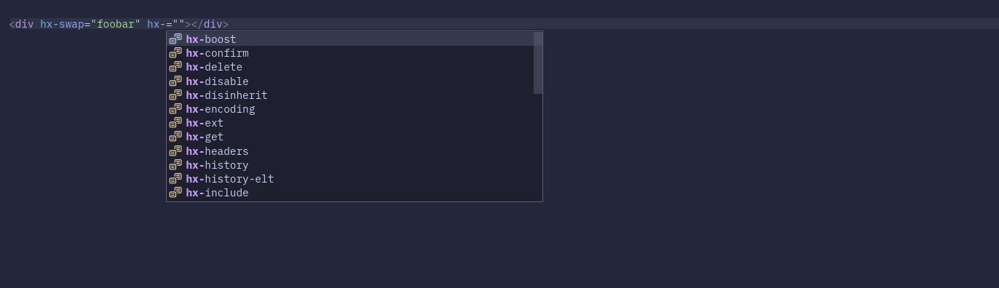
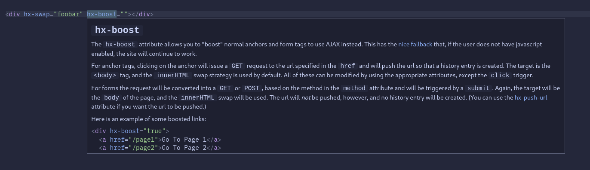

# htmx-Tags

htmx-Tags is a VSCode extension that provides autocompletion of htmx attributes and inline documentation for these attributes. The documentation for the attributes are fetched and parsed from the official documentation.

## Requirements

- Visual Studio Code version 1.74.0 or higher
- HTMX 2.0.8 (currently supported version)

## Installation

You can install the `htmx-tags` extension from the Visual Studio Code Marketplace or by searching for "htmx-tags" within the VSCode extension panel.

## Usage

After installing the extension, simply start typing an htmx attribute within an HTML tag and the extension will provide autocompletion suggestions based on the official htmx documentation.

Additionally, you can hover over an htmx attribute to see inline documentation within your code editor.

## Features

* Autocompletion of htmx attributes in HTML, django-html, and .htmx files
* Inline documentation for htmx attributes
* Context-aware completions (only triggers inside HTML tags)
* Direct links to official HTMX documentation
* Performance optimized with bundling

## Extension Settings

This extension currently has no configurable settings. It works out of the box for HTML, django-html, and .htmx files.

## Screenshots

## Known Issues

See the [GitHub Issues page](https://github.com/otovo/htmx-tags/issues) for known issues and feature requests.

## Release Notes

See [CHANGELOG.md](CHANGELOG.md) for detailed release notes.

## Contributions

Contributions to the htmx-Tags extension are welcome!

If you would like to contribute, please submit a pull request or open an issue on the GitHub repository.

## License

htmx-Tags is licensed under the Apache 2 License. See the LICENSE file for more information.

The htmx documentation is licensed under the BSD 2-clause license.

## Development

For detailed instructions on how to develop, build, and package this extension, please refer to [vsc-extension-quickstart.md](vsc-extension-quickstart.md).
